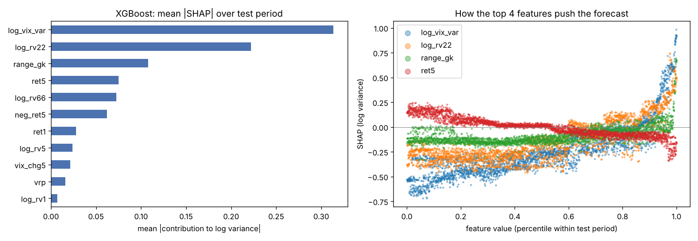

# Nifty 50 volatility forecasting

Forecast the realized volatility of the Nifty 50 over the next 5 trading days and compare
GARCH(1,1), HAR, XGBoost and an LSTM under the same walk-forward setup.

**Status:** all four steps done (baselines, GARCH, HAR, XGBoost, LSTM, SHAP). `python run.py` runs everything in
about 3 minutes on a 4-core CPU. Results below use data downloaded on 2026-10-14; a fresh download
adds later days, so numbers will shift slightly.

## Setup

```bash
python -m venv .venv
source .venv/bin/activate          # Windows: .venv\Scripts\activate
pip install -r requirements.txt
python run.py                      # first run downloads data and caches it to data/raw.csv
pytest -q                          # offline sanity checks (target alignment, no look-ahead)
```

Options: `--refresh` re-downloads data, `--horizon 5`, `--test-start 2015-01-01`, `--garch-dist t`.

### In Google Colab
```
!git clone https://github.com/BhigaBilla/nifty-volatility-forecasting
%cd nifty-volatility-forecasting
!pip install -q -r requirements.txt
!python run.py
```

`run_output.txt` is the full console output of the run behind the numbers below.

## Method

- **Data:** daily Nifty 50 (`^NSEI`) and India VIX (`^INDIAVIX`) from Yahoo Finance, 2008 onward, inner-joined on dates.
- **Target:** forward 5-day realized variance from daily close-to-close log returns,
  annualized: `RV_t = (252/5) * sum_{i=1..5} r_{t+i}^2`. Forecasts at day t use data up to the close of t only.
- **Walk-forward:** training starts in 2008; test period starts 2015-01-01. GARCH parameters are
  re-estimated every 21 trading days on an expanding window; between refits the conditional
  variance still updates daily. `tests/test_no_lookahead.py` checks that altering future returns
  leaves past forecasts unchanged.
- **Baselines:** 21-day historical variance and RiskMetrics EWMA (lambda 0.94).
- **HAR / HAR-VIX:** OLS on log variance with daily, weekly and monthly realized variance
  (Corsi 2009), optionally plus log India VIX squared.
- **XGBoost:** same log-variance target, 11 features (HAR terms, 66-day RV, VIX level and change,
  implied-minus-realized spread, recent returns and downside returns, Garman-Klass range).
  Fixed, untuned hyperparameters (depth 3, lr 0.02); the last 2 years of each training window are held
  out for early stopping. HAR and XGBoost retrain every 63 days; training rows stop h days before the
  refit date so no target overlaps the future. Log forecasts are rescaled with Duan's smearing factor.
- **LSTM (PyTorch):** one layer, 32 hidden units, reading the last 22 days of the same 11 features
  (standardized on each training window). Same log-variance target, purge gap, 2-year validation
  hold-out (early stopping) and smearing. Retrained every 126 days; each refit averages 3 seeds.
  Settings fixed up front, not tuned. Full run (all models) takes about 3 minutes on a 4-core CPU.
- **SHAP:** exact TreeSHAP from XGBoost's built-in `pred_contribs`, computed for every test day with the
  model that made that day's forecast (values in log-variance units; checked to sum to the prediction).
- **Metrics:** RMSE on annualized volatility (percentage points) and QLIKE on variance
  (Patton 2011; robust to the noisy realized-variance proxy).
- **Significance:** Diebold-Mariano with Newey-West variance (h-1 lags, since 5-day targets overlap)
  and the Harvey-Leybourne-Newbold small-sample correction.

## Results

Test period 2015-01-02 to 2026-10-07 (2,879 days), 5-day horizon. Lower is better.

| Model | RMSE (vol, pp) | QLIKE | Mean bias (vol, pp) |
|---|---|---|---|
| LSTM | 6.78 | 0.335 | +1.00 |
| XGBoost | 6.64 | 0.336 | +0.95 |
| HAR-VIX | 6.97 | 0.336 | +0.88 |
| GARCH(1,1) | 7.92 | 0.390 | +1.96 |
| HAR | 7.93 | 0.392 | +1.95 |
| EWMA | 8.09 | 0.419 | +1.07 |
| 21-day historical | 8.35 | 0.436 | +0.77 |

Diebold-Mariano (QLIKE / squared error on vol, p-values):
- GARCH beats both naive baselines on QLIKE (p = 0.003 vs historical, 0.021 vs EWMA) but not on RMSE (p = 0.12, 0.17).
- Plain HAR is no better than GARCH (p = 0.66).
- Adding India VIX to HAR is a clear gain (p = 0.001 QLIKE, < 0.001 RMSE).
- XGBoost beats GARCH (p < 0.001 on both) but **is not distinguishable from HAR-VIX** (p = 0.997 QLIKE, 0.16 RMSE).
- LSTM beats GARCH (p < 0.001 on both). On QLIKE it ties HAR-VIX (p = 0.95) and XGBoost (p = 0.93).
  It has lower RMSE than HAR-VIX (p = 0.04), which is weak evidence given how many pairs are tested.

Takeaway: the information that matters is implied volatility. Once VIX is in a linear model,
neither XGBoost nor the LSTM adds significant accuracy on QLIKE. XGBoost's most important features
(by tree gain) are VIX and the 22-day realized variance. GARCH persistence is about 0.99 and it over-forecasts volatility by about 2 points
on average, partly because GARCH reacts to large shocks and decays slowly (visible after March 2020 and June 2024).

### What drives the XGBoost forecast (SHAP)



| Feature | Share of mean abs SHAP | Direction |
|---|---|---|
| India VIX (log implied variance) | 33% | higher VIX, higher forecast |
| 22-day realized variance | 23% | higher, higher |
| 5-day Garman-Klass range | 11% | higher, higher |
| 5-day return | 8% | falls raise the forecast (leverage effect) |
| 66-day realized variance | 8% | higher, higher |
| 5-day downside return | 7% | falls raise the forecast |

The other five features share the remaining 10%. In the March 2020 crash the largest average
contributions were VIX (+0.86 log variance, about 2.4x), the intraday range (+0.58) and 22-day RV (+0.53).
This lines up with the model comparison: VIX carries most of the signal, which is why linear HAR-VIX
matches the nonlinear models.

## Limitations

- Realized volatility from 5 daily returns is a very noisy proxy; intraday data would give a much
  cleaner target but is not freely available for this history.
- Close-to-close returns ignore overnight vs intraday structure and gap risk.
- Yahoo Finance index data can contain stale or missing days; `run.py` prints zero-return days to check.
- Each model is trained once with fixed settings; no hyperparameter search, so XGBoost and the LSTM
  may be under-tuned, but nothing was tuned on the test period.
- GARCH(1,1) with normal errors is symmetric and thin-tailed; no leverage effect (GJR/EGARCH not used).
- Diebold-Mariano p-values are not corrected for the number of pairs tested (18 tests).
- The LSTM retrains half as often as XGBoost (126 vs 63 days) to keep CPU time down.
- SHAP explains the XGBoost model only; the LSTM is not explained.
